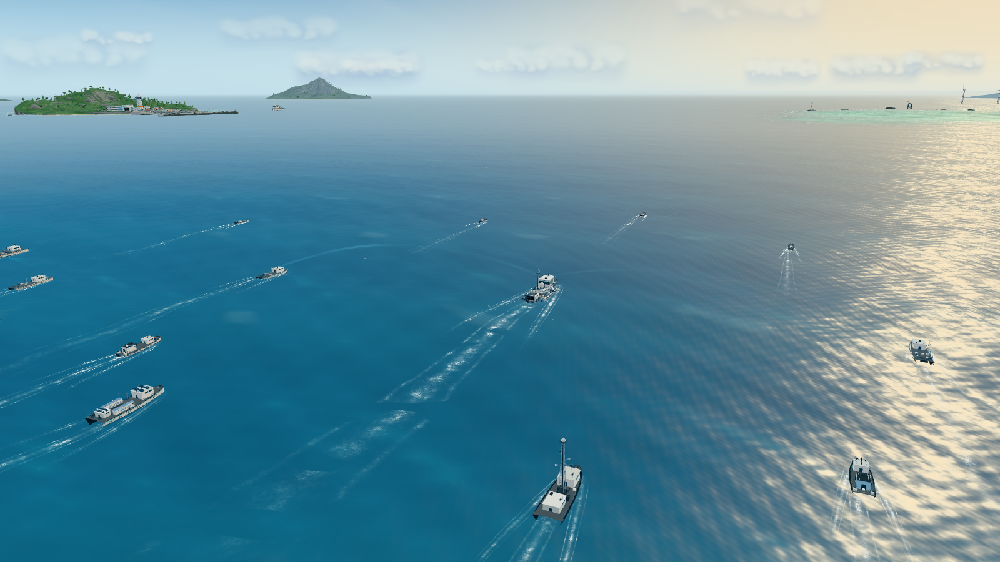
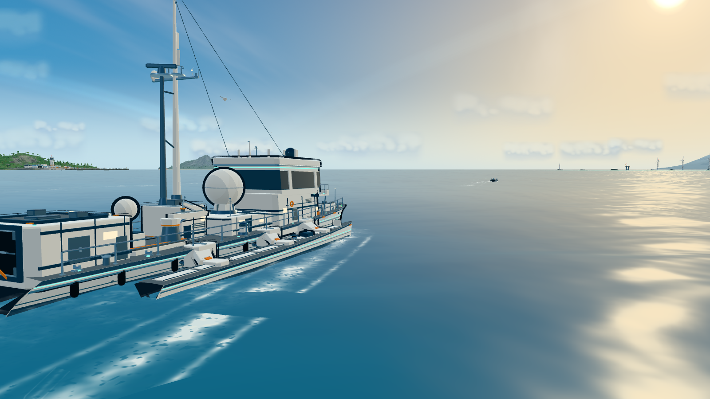
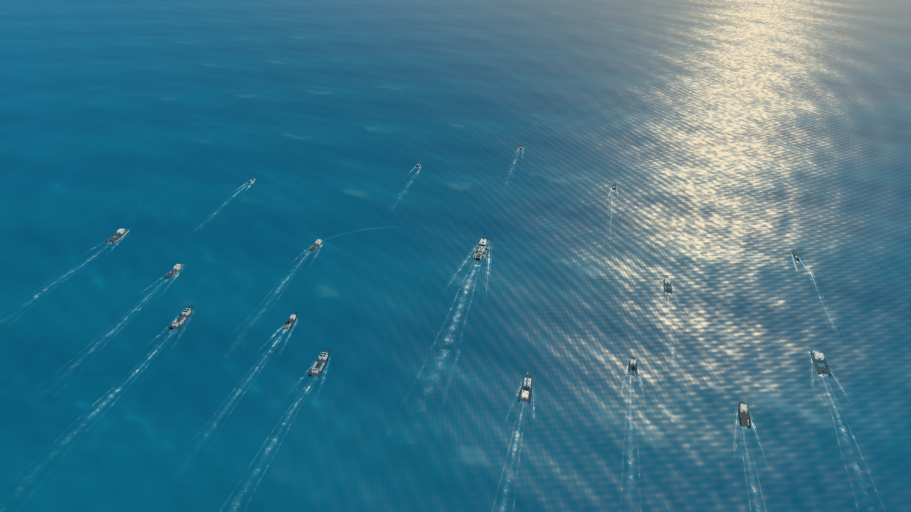
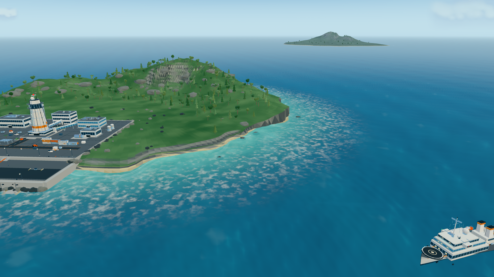
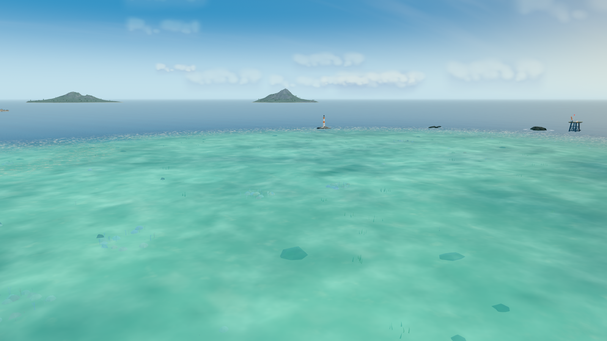
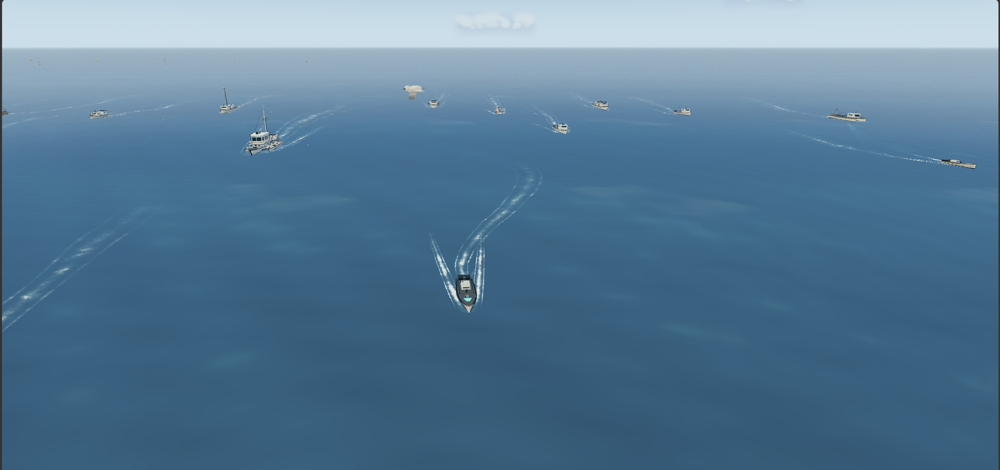
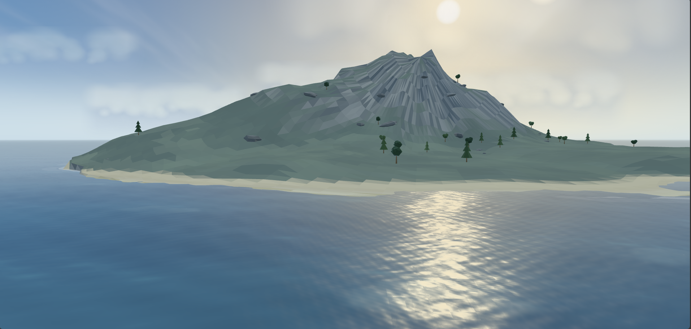

# OceanSwarm — 未来智能无人艇集群协同巡航海域

一片数公里尺度的开放海域，17 艘不同类型的智能无人艇（含一艘 30 m 三体无人指挥旗舰）以协同编队巡航。
全部场景内容由 Three.js 程序化几何与着色器实时生成，不使用任何外部贴图、模型或 HDR 资源。



- 项目仓库：<https://github.com/ZHT1235456/OceanSwarm>
- 开发文档（中文 LaTeX）：[docs/OceanSwarm-dev-doc.pdf](docs/OceanSwarm-dev-doc.pdf) · [LaTeX 源码](docs/OceanSwarm-dev-doc.tex)

## 效果预览

| | |
|---|---|
|  |  |
|  |  |
|  |  |

## 运行

```bash
npm install
npm run dev        # http://127.0.0.1:5179
npm run build      # production build (dist/)
```

## 交互

纯第三人称自由视角，无任何 UI / 文本 / 悬浮面板：

- 左键拖拽：旋转视角
- 滚轮：平滑缩放（16 m – 4200 m）
- 右键拖拽：平移观察
- 视角带阻尼；相机随编队缓慢巡航，可自由靠近水面观察船体、或拉高俯瞰整个集群

## 场景内容

- **海洋**：自定义 ShaderMaterial 程序化海面；CPU/GPU 共享 7 组方向波，船体随浪起伏 / 纵摇 / 横摇；
  菲涅尔天空反射、太阳碎金反射、稀疏白浪、云影、深浅水色与大气雾；海面网格跟随相机、半径 26 km，
  与天空穹顶共用同一套天空色函数，地平线无缝衔接。
- **无人艇集群**：1 艘 30 m 三体旗舰（双雷达罩、通信桅杆、旋转雷达、光电球、UUV 机库、折臂吊、
  舷侧灯带 / 护舷 / 护栏 / 航行灯），以及 16 艘 10–20 m 的高速侦察、环境监测、海洋测绘（双体）、
  多用途巡逻、通信中继、能源保障、无人救援艇；程序化 Builder 合批几何 + 卡通轮廓线。
- **编队与航行动画**：旗舰沿数公里尺度的大圆弧缓慢转向，各艇保持编队阵位并带自然摆动；
  侦察艇周期性向外展开；软弹簧跟随 + 差异化的航向修正。
- **尾迹 / 技术光效**：17 套独立的历史轨迹尾迹带、船首 V 形破浪、船侧泡沫线、尾流泡沫；
  克制的青蓝色通信弧线、扫描波纹与测绘扇形探测光束；海鸥群。
- **环境**：左侧中远景岩石海岛上的未来海洋无人系统试验基地（指挥塔 / 模块建筑 / 栈桥码头 / 无人艇泊位）、
  120 m 海洋保障母船、右侧浅海珊瑚礁潟湖（海底沙脊 / 珊瑚 / 海草 / 鱼群）、航标浮标阵列、灯塔、
  海上观测平台、远方风电场、三座远近海岛；程序化天空穹顶、卷云 / 积云、低角度暖阳。

## 代码结构

```
src/
  main.js                 场景装配、渲染循环、相机预设、灯光、QA 调试钩子
  config.js               调色板 / 世界布局 / 编队名册 / 相机与光照参数
  core/
    geo.js                程序化几何工具、Builder 合批、船体 hullParts 生成器
    materials.js          卡通材质库 + 程序化天空环境反射
    waves.js              CPU/GPU 共享波场
    ocean.js              海面网格与海洋着色器
    sky.js                天空穹顶、云层、太阳与共享天空色 GLSL
  systems/formation.js    编队航路、阵位保持、随浪姿态
  objects/
    ships/                旗舰与 7 级无人艇程序化模型
    world/                海岛 / 珊瑚礁 / 海上基地 / 母船 / 航标与设施
    effects/              尾迹 / 通信与扫描光效 / 海鸥
```
